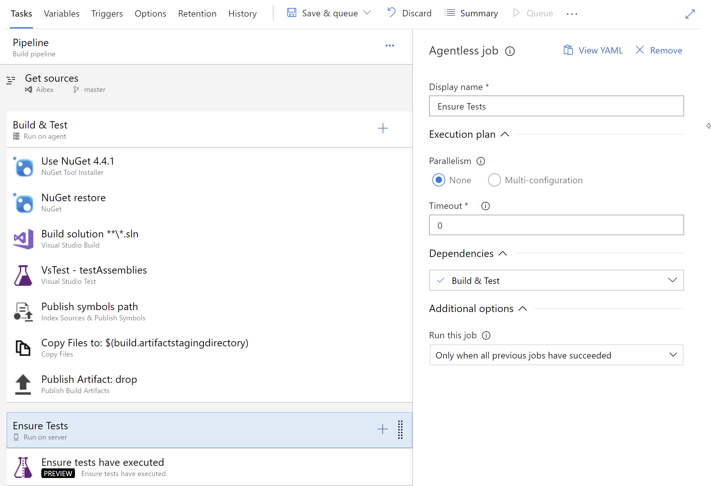

# Release Notes
> **2018-09-07**
> - Initial preview version

# Description

This extension provides a build task that allows you to quickly fail a build if it didn't execute any tests. This task uses "Server Phase". Be sure to set the dependency of this phase to the phases that run the tests.

# Documentation

If you like this extension, please leave a review and feedback. If you'd have suggestions or an issue, please [file an issue to give me a chance to fix it](https://github.com/jessehouwing/vsts-ensure-tests/issues).

# Releases

Pull requests and pushes to `main` package the extension with the released `azdo-marketplace` action and do not publish it. A manual release runs the same package action, installs an isolated private preview, and runs `.github/pipelines/test-ensure-tests.yml` before production publication. The task version is aligned to the extension version during packaging.

Create an Azure Pipelines definition from `.github/pipelines/test-ensure-tests.yml` for the regression target. It covers builds with zero and one published test result and can be copied to another organization.

Configure these repository variables before dispatching a release: `AZDO_ORGANIZATION_URL`, `AZDO_PROJECT`, and `AZDO_TEST_PIPELINE_NAME`. They identify the Azure DevOps organization, project, and pipeline that runs the regression YAML. Configure the `AZURE_CLIENT_ID` and `AZURE_TENANT_ID` repository secrets, an Entra federated credential for issuer `https://token.actions.githubusercontent.com`, audience `api://AzureADTokenExchange`, and subject `repo:jessehouwing/azure-pipelines-ensure-tests-task:environment:marketplace`. The application service principal must have the required Azure DevOps and `jessehouwing` Marketplace access. Protect the `marketplace` and `release-publish-approval` environments with reviewer approval while allowing the sole maintainer to self-review. No Azure subscription is required.
